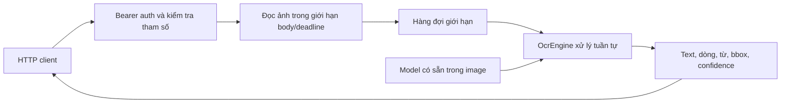

# API service và triển khai

Service v0.2.0 dùng Node.js và ONNX Runtime CPU. Docker image đóng gói file
`oneocr.onemodel` gốc, Sharp và các native dependency Linux amd64. Không gọi
Windows, Wine, dịch vụ OCR ngoài hoặc tải model lúc khởi động.



## Hợp đồng HTTP

| Method/path | Mục đích | Auth |
| --- | --- | --- |
| `POST /v1/ocr` | Một ảnh PNG/JPEG/WebP/TIFF/BMP/GIF, raw hoặc multipart; layout, tiền xử lý và trích xuất JSON sau OCR là tùy chọn | Bearer API key |
| `GET /health/live` | Process còn hoạt động | Không |
| `GET /health/ready` | Engine đã nạp detector/classifier, số request pending | Không |
| `GET /openapi.json` | OpenAPI 3.0.3 | Không |

Alias OCR: `/api/v1/ocr`, `/ocr`, `/`. Alias readiness: `/health`, `/api/health`.
Readiness không có nghĩa tất cả recognizer đã được warm-up: các hệ chữ khác
được nạp khi sử dụng. Test integration riêng kiểm tra nạp đủ 34 model.

```bash
set -a; . ./.env; set +a
curl --fail-with-body -H "Authorization: Bearer $ONEOCR_API_KEY" \
  -H 'Content-Type: image/png' --data-binary @image.png \
  'http://127.0.0.1:8001/v1/ocr?language=vi&max_lines=100'

curl --fail-with-body -H "Authorization: Bearer $ONEOCR_API_KEY" \
  -F file=@image.png 'http://127.0.0.1:8001/v1/ocr?language=vi'
```

Multipart nhận đúng một file ở field `file` hoặc `image`. Không nhận đường dẫn
file/URL từ client. TIFF nhiều trang/GIF động chỉ xử lý trang/frame đầu tiên.
Query mặc định: `language` hoặc `script`, `max_lines`, `resize_long`,
`resize_short`, `min_confidence`, `reject_low_quality`. Tùy chọn thêm
`layout=deepdoc`, `layout_threshold`, `max_regions`, `max_dimension`, `rotation`,
`deskew`, `padding` và `extract=needle`. Query lặp, không biết hoặc ngoài giới
hạn trả 422.

Kết quả giữ các trường của engine: `text`, `text_angle`, `lines[].words[]`,
`bounding_rect`, confidence, style, rejection, `width`, `height`, `elapsed_ms`,
`model_sha256`, `provenance`. Khi bật tiền xử lý hoặc layout, tọa độ và kích thước
ảnh dùng hệ `decoded_image_pixels_after_exif`; phản hồi có `coordinate_space` và
metadata affine `preprocessing` để xem phép biến đổi thuận/nghịch. Service thêm
`request_id` và header `X-Request-ID`. `elapsed_ms` tính preprocessing và OCR
nhưng không tính thời gian chờ queue, giải mã ảnh, HTTP upload hoặc extraction;
`extraction.elapsed_ms` đo toàn giai đoạn extraction, gồm kiểm tra schema/context,
verify model hash, nạp runtime/worker lần đầu, inference và dọn dẹp khi hủy.
Log request có `duration_ms` cho toàn bộ request.

Lỗi có dạng `{"error":"invalid_options","message":"...","request_id":"..."}`.
400: ảnh/multipart sai; 401: key sai/thiếu; 413: body quá lớn; 415: MIME không
hỗ trợ; 422: tham số/kích thước ảnh hoặc schema sai; 500: lỗi engine; 503: hàng
đợi đầy, đang dừng hoặc slot Needle bận (`Retry-After: 1`); 504: deadline request
đã hết. Timeout extraction riêng được trả trong `extraction.status` nếu OCR đã
hoàn tất. 404/405 xử lý route/method sai.

## Tiền xử lý và layout tùy chọn

Mặc định không resize, xoay, deskew hoặc thêm padding; bỏ `layout` tiếp tục chạy
OneOCR trên toàn ảnh như trước. `max_dimension` (32..4096) chỉ thu nhỏ cạnh dài
và giữ tỉ lệ; `rotation` (-180..180 độ) mở rộng canvas và tô trắng; `deskew=true`
dùng ước lượng góc nhỏ có giới hạn; `padding` (0..128) thêm pixel trắng mỗi cạnh.
Các phép biến đổi chạy trước layout/OCR, rồi ánh xạ hộp trở lại ảnh sau EXIF.

```bash
curl --fail-with-body -H "Authorization: Bearer $ONEOCR_API_KEY" \
  -F file=@page.png \
  'http://127.0.0.1:8001/v1/ocr?language=vi&layout=deepdoc&max_dimension=1600&deskew=true&padding=16'
```

Layout model nằm trong image ở `/app/models/deepdoc-layout.onnx`; đổi đường dẫn
bằng `ONEOCR_LAYOUT_MODEL_PATH`. File được kiểm tra với kích thước và SHA-256 đã
pin; ONNX session CPU chỉ mở ở request layout đầu tiên. `GET /health/ready` báo
`semantic_layout_available`, nhưng không khởi tạo inference session.

Response layout có vùng `layout.regions[]` với label/score/bbox, trạng thái OCR,
và các dòng OneOCR tương ứng. Model phát hiện vùng `table`, nhưng OneOCR chỉ đọc
crop của vùng đó; service không nhận dạng hàng/cột, không ghép ô và không xuất
Excel. Xem [tiền xử lý, class map và giới hạn](PREPROCESSING-LAYOUT.md) cùng
[receipt đo hiện tại](evidence/preprocessing-layout.md).

### Trích xuất JSON bằng Needle (tùy chọn)

`extract=needle` chạy model Needle cục bộ sau OCR trên `result.text`. Chỉ nhận
multipart gồm đúng một file `file` hoặc `image`, một trường văn bản `schema`
chứa JSON Schema và tối đa một trường văn bản `instruction`. Raw image khi bật
extraction trả 422. Ví dụ dùng schema, giới hạn và response nằm trong
[hướng dẫn Needle](NEEDLE-EXTRACTION.md).

Response giữ các trường OCR và thêm object `extraction` với provider/model,
`schema_validation`, `output_validation`, `status`, thời gian, byte/context
metadata và `data` khi thành công. Schema không hợp lệ hoặc thiếu trả 422 trước
OCR. Sau OCR, extraction `timeout`, `unavailable`, `input_too_large`, `no_match`
hoặc `invalid_model_output` được trả trong HTTP 200 và không xóa OCR result.
Nếu deadline tổng của request hết, HTTP trả 504. Một
extraction đồng thời được phép mỗi process; request cạnh tranh trả 503
`extraction_busy` với `Retry-After: 1` trước OCR. Mặc định timeout riêng là 15
giây, nằm trong deadline request 60 giây. Model được kiểm tra SHA-256 khi dùng
lần đầu; không tải weights từ mạng.

`GET /health/ready` cũng trả `json_extraction_model_available`,
`json_extraction_provider`, `extraction_pending` và `max_extraction_pending`.
Availability chỉ xác nhận file model tồn tại; kiểm tra hash và khởi tạo runtime
xảy ra ở lần extract đầu tiên. `extraction_pending` giữ chỗ cho toàn request
extraction, gồm upload và OCR trước khi model chạy.

## Tài nguyên và vòng đời

Mỗi replica có một engine xử lý tuần tự; có thể nhận tối đa 8 request upload,
đang chờ hoặc đang chạy. Request thứ 9 trả 503. Deadline tính từ lúc được chấp
nhận, gồm upload, chờ và inference. Nếu quá deadline, HTTP trả 504 và signal
hủy được chuyển vào engine. Một ONNX call đang chạy không thể bị ngắt giữa
chừng; slot vẫn được giữ đến khi công việc thực sự kết thúc. Scale bằng nhiều
replica phía sau load balancer khi cần throughput lớn hơn.

SIGTERM/SIGINT ngừng nhận kết nối mới, đợi request đang chạy và đóng session.
Sau `ONEOCR_SHUTDOWN_TIMEOUT_MS`, server hủy signal và đóng socket còn lại;
Docker có thể kết thúc process sau `stop_grace_period` nếu native call chưa về.
Thời gian stop mặc định của Compose là 70 giây.

Service không ghi ảnh hoặc OCR text xuống disk. Log JSON gồm event, method,
status, request ID và thời gian; không ghi authorization, query, ảnh hoặc text.
API key chỉ được so sánh qua digest có độ dài cố định. Khi chạy trực tiếp bằng
Node, bỏ `ONEOCR_API_KEY` sẽ cho phép dùng local không auth; Compose bắt buộc key.

## Cấu hình

Tạo `.env` với `node tools/init-service.mjs`; key ngẫu nhiên 32 byte, không
in ra console, không ghi đè `.env` đã có. Xem `.env.example`.

| Biến | Mặc định Compose | Ý nghĩa |
| --- | --- | --- |
| `ONEOCR_IMAGE` | `oneocr-next:local` | Tag hoặc digest image |
| `ONEOCR_BIND_ADDRESS` | `127.0.0.1` | Interface publish trên host |
| `ONEOCR_PUBLISHED_PORT` | `8001` | Port trên host |
| `ONEOCR_API_KEY` | Bắt buộc | Bearer key, ít nhất 32 ký tự |
| `ONEOCR_MODEL_PATH` | `/app/models/oneocr.onemodel` | Model đã có trong image |
| `ONEOCR_LAYOUT_MODEL_PATH` | `/app/models/deepdoc-layout.onnx` | Model layout tùy chọn đã có trong image |
| `ONEOCR_NEEDLE_MODEL_PATH` | `/app/models/needle3.cact` | Model trích xuất JSON tùy chọn đã có trong image |
| `ONEOCR_THREADS` | `2` | Số thread cho mỗi ORT session, 1..16 |
| `ONEOCR_MAX_PENDING` | `8` | Tổng request được nhận, 1..64 |
| `ONEOCR_MAX_BODY_BYTES` | `20971520` | Body tối đa 20 MiB, gồm multipart |
| `ONEOCR_MAX_PIXELS` | `40000000` | Giới hạn ảnh giải mã |
| `ONEOCR_REQUEST_TIMEOUT_MS` | `60000` | Deadline 60 giây |
| `ONEOCR_EXTRACTION_TIMEOUT_MS` | `15000` | Deadline extraction, 10..600000 ms |
| `ONEOCR_SHUTDOWN_TIMEOUT_MS` | `65000` | Chờ drain socket |
| `ONEOCR_CPUS` | `2` | CPU limit của container |
| `ONEOCR_MEMORY_LIMIT` | `2g` | RAM limit của container |

Compose dùng filesystem read-only, tmpfs `/tmp` 64 MiB, user `node`, bỏ Linux
capabilities, `no-new-privileges`, PID limit và log rotation. Không có volume
model hoặc Docker socket. Model/runtime nằm trong image, key nằm ngoài image.
Để cung cấp qua Internet, đặt service sau reverse proxy HTTPS và giới hạn truy
cập cổng backend; không truyền Bearer key qua HTTP công cộng.

## Deploy, cập nhật và rollback trên Linux

```bash
docker compose up -d --build --wait --wait-timeout 120
docker compose ps
docker compose logs --tail 100 ocr
curl --fail http://127.0.0.1:8001/health/ready
```

GitHub Actions build/publish GHCR sau khi test và gọi service thật đạt. Các tag:
`latest` cho `main`, `sha-<full commit>` cho mọi push được publish, `v*` cho
release tag. Đặt trong `.env`, ví dụ `ONEOCR_IMAGE=ghcr.io/orggem/one-ocr-next:sha-...`, rồi:

```bash
docker compose pull ocr
docker compose up -d --no-build --wait --wait-timeout 120
```

Rollback bằng cách đặt lại tag/digest trước đó rồi chạy lại hai lệnh trên.
Giữ `.env` hiện có để giữ API key. `docker compose down` dừng deployment này.
Build và publish gồm model OneOCR và DeepDoc layout đã pin; không có DLL hay tool
nghiên cứu Windows.

## Kiểm chứng

`npm test`: runtime/model thật và HTTP lifecycle; `npm run test:unit`: không
cần model; `npm run test:service`: service Docker đang chạy, ảnh tiếng Việt
PNG/JPEG/WebP, bảng 23 ô/13 giá trị số, auth và lỗi HTTP. Receipt tại
`docs/evidence/service-verification.json`; key không được lưu trong receipt.

`npm run test:vi` là suite ảnh chuyên biệt với tiêu chí nghiêm ngặt: hiện 7/8
ảnh đạt, dãy dấu đứng riêng còn lỗi nên trả exit code 1. Chạy full suite này
riêng khi đánh giá chất lượng OCR; đây không phải kết quả được bỏ qua để tuyên
bố full parity. Tài liệu bảng kiểm tra nội dung/vị trí từ, chưa cung cấp API
khôi phục cấu trúc bảng/ô gộp hoặc xuất Excel. Linux amd64 đã kiểm tra; ARM64,
GPU và chất lượng tài liệu scan thực chưa được kiểm chứng.

Tham khảo cấu hình nền tảng: [Docker Compose services](https://docs.docker.com/reference/compose-file/services/),
[GitHub: publish Docker images](https://docs.github.com/en/actions/tutorials/publish-packages/publish-docker-images).
